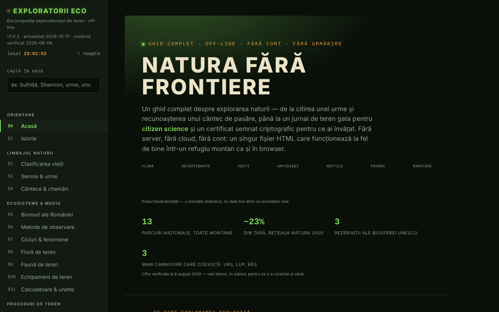

# Exploratorii Eco

[English](README.md) · [Română](README.ro.md) · [Français](README.fr.md) · [Italiano](README.it.md) · [Español](README.es.md) · [Português](README.pt.md) · **Deutsch** · [Magyar](README.hu.md)

**Version:** 1.1.0 · **Zuletzt aktualisiert:** 2026-10-14

Die Enzyklopädie der Feldforscherin und des Feldforschers: Naturführer, Beobachtungsjournal und Feldwerkzeuge in einer einzigen HTML-Datei.

**Live:** https://chiuta.github.io/ExploratoriiEco/

## Was es ist

Ein vollständiger Führer zur Erkundung der Natur, in 20 Abschnitten (§0–§19): Klassifikation des Lebens, Zeichen und Spuren, Gesänge und Rufe, Biome Rumäniens, Beobachtungsmethoden, Feldflora und -fauna, Ausrüstung, Rechner, Feldverfahren, Journal und Citizen Science, Ethik (Leave No Trace), Abzeichen, Notfälle, Schutzgebiete, Wissenstest und A–Z-Glossar. Der Inhalt ist bildend; bei wichtigen Entscheidungen (Zugang zu Schutzgebieten, streng geschützte Arten, Notfälle) verweist die App auf ANMAP und Salvamont România als maßgebliche Quellen.

## Funktionen

- Navigation nach Abschnitten über das Seitenmenü (☰ auf dem Handy); Design **Nacht / Tag** (Tasten ☾ / ☀; beim ersten Öffnen folgt es der Systemeinstellung).
- **Suche im Führer** (Seitenmenü): durchsucht den Volltext der 20 Abschnitte, ohne Diakritika (z. B. „bufnita“, „Shannon“); filtert das Menü, die Eingabetaste öffnet den am besten passenden Abschnitt, Esc leert das Feld.
- **Rechner und Werkzeuge** (§11): Shannon-Wiener-Biodiversitätsindex, Maidenhead-Locator, Azimut und Entfernung zu einem Ziel (mit Live-Kompass, wenn das Gerät es unterstützt), Luftabkühlung mit der Höhe, CO₂-Fußabdruck einer Fahrt, Kohlenstoffbindung durch Bäume. Die Berechnungen erfolgen lokal, in der Seite.
- **Ruftrainer** (§4): synthetisierte Töne (keine echten Aufnahmen) zum Erkennen bestimmter Muster, dazu das Vorlesen der lautmalerischen Bezeichnung über die Sprachsynthese des Browsers, falls verfügbar.
- **Feldjournal** (§13): Du fügst Beobachtungen hinzu (Art, Anzahl, Datum, Uhrzeit, Ort, Verhalten, Notizen), mit auf Wunsch per GPS ausgefülltem Ort; `.json`-Export und -Import, Teilen als Datei. Der Zähler zeigt „nicht exportiert“ bis zum Export, und beim Verlassen der Seite mit nicht exportierten Beobachtungen fragt der Browser nach einer Bestätigung (das Journal bleibt nur dann im Browser erhalten, wenn du „Journal auf diesem Gerät behalten“ ankreuzt).
- **Wissenstest** (§18): Zufallsmodus oder nach Kategorien, Punktestand, Fortschritt pro Kategorie mit Export/Import.
- **Lokale Identität und Zertifikate**: Erzeugung eines ECDSA-P-256-Schlüssels im Browser, selbstsigniertes Zertifikat der gemeisterten Kategorien (mindestens 80 % richtig und 5 Fragen pro Kategorie), Prüfung, „Zeuge“, Widerruf. Es ist kein offizielles Diplom.
- **A–Z-Glossar** mit Suche und eigenen Notizen (Export/Import).
- Abzeichen, berechnet aus dem Journal und dem Wissenstest, solange die Seite geöffnet ist.
- **Aktuellen Abschnitt drucken**, Vollbildmodus für den Test, Schaltfläche „Fehler melden“ (öffnet das GitHub-Issues-Formular).
- **Dateiintegrität prüfen**: auf Anforderung wird der SHA-256 der ausgelieferten Datei berechnet.

## Neue Funktionen (v1.1.0, 14. Oktober 2026)

Keine neuen Lernfunktionen in dieser Version: **Die verteilte Wiederholung gibt es bereits** (Abschnitt Wissenstest, SM-2 mit Export/Import) und wurde nicht doppelt angelegt. Neu ist das folgende Kit; die Sicherung enthält **das Beobachtungsjournal**, wenn du es auf dem Gerät behalten hast (`exploratorii-eco-jurnal-v1`).

### Transparenz und Sicherung (fff-kit)

Ein Klick (oder die Eingabetaste) auf die angezeigte Version (`v 1.1.0 · 2026-10-14`) öffnet das Fenster „Transparenz“: die deklarierten Netzwerk-Hosts (0 externe Anfragen), die lokalen Speicherschlüssel mit Größen, die verwendeten APIs, Größe und SHA-256 der Datei (mit einem Prüfer für eine heruntergeladene Datei) und die **Sicherung** der App-Daten in eine `.fff.json`-Datei (optional mit Passwort verschlüsselt, AES-GCM 256 / PBKDF2; das Passwort lässt sich nicht wiederherstellen), Import mit Bestätigung und Löschen der App-Daten. Das Kit (`fff-kit`, Module: core, label, bundle) ist in `index.html` eingefügt, stellt keine Netzwerkanfragen und verändert keine vorhandenen Daten; ohne es funktioniert die App genauso. Das Journal kann Standorte und persönliche Beobachtungen enthalten: Nutze „Verschlüsselt exportieren“ für Dateien, die weitergegeben werden. Die Texte des Kits liegen in 8 Sprachen vor (ro, en, fr, it, es, pt, hu, de); **die Übersetzungen fr/it/es/pt/hu/de sind maschinell erstellt und nicht von Muttersprachlern geprüft**. Die Oberfläche der App selbst bleibt auf Rumänisch.

## Anleitung

1. Öffne die Seite und wähle im linken Menü einen Abschnitt.
2. Für das Journal gehe zu „§13 Journal & Citizen Science“, fülle die Felder aus und drücke **+ Beobachtung hinzufügen**; danach **💾 Exportieren (.json)**, um die Daten zu sichern.
3. Um das Journal wieder aufzunehmen, drücke **📂 Importieren** und wähle die zuvor exportierte Datei.
4. Für die Rechner gehe zu „§11 Rechner & Werkzeuge“; die Schaltflächen „📍 Meinen Standort verwenden“ fragen die Standortberechtigung des Browsers ab.
5. Wähle in „§18 Wissenstest“ eine Kategorie oder antworte direkt; **💾 Fortschritt exportieren** und **📂 Fortschritt importieren** bewahren die Ergebnisse zwischen den Besuchen.
6. Für ein Zertifikat: **🔑 Identität erzeugen**, dann **📜 Zertifikat erzeugen**; exportiere die Identität als Reserve.
7. Wechsle das Design mit **☾ Nacht / ☀ Tag**; drucke den aktuellen Abschnitt mit **🖨️ Aktuellen Abschnitt drucken**.

## Warnhinweis

Bildungs- bzw. Orientierungsinhalt. Die Abschnitte über Notfälle, Schlangen, Zecken, Pilze und Pflanzen ersetzen weder einen Erste-Hilfe-Kurs noch ärztlichen Rat noch die Behörden (112, Salvamont, ANMAP); Pflanzen und Pilze werden nicht auf Grundlage des Führers verzehrt. Die App zeigt in der Fußzeile einen Hinweis mit gleichem Inhalt. Die erzeugten „Zertifikate“ sind selbstsignierte Nachweise deines eigenen Fortschritts, keine offiziellen Diplome.

## Datenschutz und Netzwerk

- **Speicher:** Die einzige Verwendung von `localStorage` (Schlüssel `exploratorii-eco-jurnal-v1`) ist die optionale Kopie des Journals, aktiv nur, wenn du „Journal auf diesem Gerät behalten“ ankreuzt; kein sessionStorage oder IndexedDB. Das Journal (ohne Haken), die Punktestände, die Glossarnotizen und die kryptografische Identität liegen nur im Arbeitsspeicher und verschwinden beim Neuladen der Seite, wenn du sie nicht exportierst.
- **Netzwerk:** Die Seite lädt keine externen Skripte, Schriften oder Bilder und hat keine Analytik. Die einzige Netzwerkanfrage erfolgt auf Wunsch des Nutzers: Die Schaltfläche „Dateiintegrität prüfen“ liest die Datei erneut von der Adresse, von der sie ausgeliefert wird. Die Links in der Fußzeile (ANMAP, iNaturalist, GBIF, IUCN, Salvamont, fiipregatit.ro, GitHub, TROM) öffnen sich nur per Klick.
- Browserberechtigungen werden nur bei der jeweiligen Aktion angefordert: Standort (GPS), Ausrichtung/Kompass, Sprachsynthese, Dateifreigabe.

## Lokale Nutzung / offline

Lade `index.html` herunter und öffne sie in einem Browser. Die App funktioniert ohne Internet; die Integritätsprüfung kann vom Browser bei direkt von der Festplatte geöffneten Dateien blockiert werden (die App zeigt in diesem Fall eine Meldung).

## Lizenz

MIT — siehe Datei `LICENSE`. © 2026 Alexandru-Ionuț Chiuță (Alexio). Eventuelle in der Datei enthaltene Drittanbieter-Bibliotheken behalten ihre eigenen Lizenzen.

## Audit

Audit: 2026-10-10 — geprüft mit Playwright und axe-core (alle 20 Abschnitte, beide Designs); kein `localStorage`; Journal und Import mit `` getestet (maskiert). Behoben: unsichtbare Überschriften im Design „Tag“ (weißer Text auf hellem Hintergrund), Kontrast, ungültige Definitionsliste im Glossar.

## Verlauf / Changelog
- v1.1.0 — 2026-10-14: fff-kit (Transparenz + einheitliche Sicherung, einschließlich Journal). Inhalt und verteilte Wiederholung haben sich nicht geändert.

- 1.0.4 — 2026-10-12: Version und Datum der letzten Aktualisierung werden in der App angezeigt (faktischer Inhalt zuletzt am 2026-08-06 geprüft; die Neuorganisation ANANP → ANMAP am 11.10.2026 per Websuche erneut bestätigt).
- v1.0.3: **optionales Behalten des Journals auf dem Gerät** (Kontrollkästchen in §13, standardmäßig deaktiviert; `localStorage`, Schlüssel `exploratorii-eco-jurnal-v1`, mit Warnung für gemeinsam genutzte Geräte; Abwählen löscht die Kopie; wenn aktiv, erscheint die Warnung beim Verlassen der Seite nicht mehr); **der Journal-Import überspringt bereits vorhandene identische Beobachtungen** (keine Verdopplung mehr beim erneuten Import). CSP-Hash neu berechnet; axe-core = 0 Verstöße bei 1280 und 360 px.
- v1.0.2: Suche im gesamten Führer; Warnung beim Verlassen der Seite mit nicht exportierten Beobachtungen (+ Anzeige „nicht exportiert/exportiert“ im Journal); das Anfangsdesign folgt `prefers-color-scheme`. CSP-Hash neu berechnet; axe-core = 0 Verstöße bei 1280 und 360 px, in beiden Designs.
- v1.0.1: Der Shannon-Wiener-Rechner startet mit einem vorausgefüllten Beispiel (Buche, Tanne, Fichte, Hainbuche, Bergahorn) und zeigt H′ von Anfang an.
- Die Kategorieleiste im Hero bricht auf dem Handy um (die Beschriftungen kleben nicht mehr aneinander); die Ränder der Startseite sind auf schmalen Bildschirmen auf 20 px reduziert.
- Die obere Leiste ist ein `<header>`, die Fußzeilenüberschriften sind h2; eine CSP-Richtlinie wurde hinzugefügt (`connect-src 'self'` für die Integritätsprüfung). axe-core = 0 Verstöße bei 1280 und 360 px.

## Autor

Alexio — Alexandru-Ionuț Chiuță. Aus der Fußzeile verweist die App auf das Centrul STRING (CSPCF). Kontakt: alexio@trom.tf

## Zusammenfassung

Exploratorii Eco ist eine rumänischsprachige Enzyklopädie für Feldnaturforscher in einer einzigen Datei: 20 Abschnitte, Rechner (Shannon-Wiener-Index, Maidenhead-Locator, Peilung, Temperaturgradient, Kohlenstoff), ein Feldjournal mit JSON-Export/-Import, ein Quiz und lokal erzeugte signierte Zertifikate (ECDSA). Sie nutzt keinen Browserspeicher (der Zustand geht beim Neuladen verloren, wenn er nicht exportiert wird) und stellt keine Netzwerkanfragen außer einer optionalen Prüfung der Dateiintegrität. Lizenziert unter MIT.
