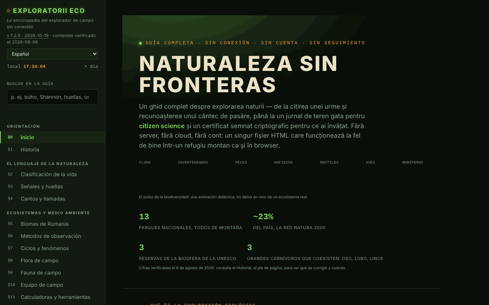

# Exploratorii Eco

[English](README.md) · [Română](README.ro.md) · [Français](README.fr.md) · [Italiano](README.it.md) · **Español** · [Português](README.pt.md) · [Deutsch](README.de.md) · [Magyar](README.hu.md)

**Versión:** 2.0.1 · **Última actualización:** 2026-10-27

**Estado:** estable · **Sin conexión:** completo

Idiomas de la interfaz: **Română, English, Français, Italiano, Español, Português (PT), Deutsch, Magyar**

La enciclopedia del explorador de campo: guía de la naturaleza, diario de observaciones y herramientas de campo en un solo archivo HTML.

**En línea:** https://chiuta.github.io/ExploratoriiEco/

## Qué es

Una guía completa para explorar la naturaleza, en 20 secciones (§0–§19): clasificación de la vida, señales y huellas, cantos y reclamos, biomas de Rumanía, métodos de observación, flora y fauna de campo, equipamiento, calculadoras, procedimientos de campo, diario y ciencia ciudadana, ética (Leave No Trace), insignias, emergencias, áreas protegidas, test de conocimientos y glosario A–Z. El contenido es educativo; para decisiones importantes (acceso a áreas protegidas, especies estrictamente protegidas, emergencias) la aplicación remite a ANMAP y Salvamont România como fuentes de referencia.

## Funciones

- Navegación por secciones desde el menú lateral (☰ en móvil); tema **Noche / Día** (botones ☾ / ☀; en la primera apertura sigue la preferencia del sistema).
- **Búsqueda en la guía** (menú lateral): busca en el texto completo de las 20 secciones, sin diacríticos (p. ej., «bufnita», «Shannon»); filtra el menú, Intro abre la sección más relevante, Esc vacía el campo.
- **Calculadoras y herramientas** (§11): índice de biodiversidad de Shannon–Wiener, locator Maidenhead, acimut y distancia hasta un objetivo (con brújula en vivo, si el dispositivo lo permite), enfriamiento del aire con la altitud, huella de carbono de un desplazamiento, secuestro de carbono por los árboles. Los cálculos se hacen localmente, en la página.
- **Entrenador de reclamos** (§4): tonos sintetizados (no grabaciones reales) para reconocer ciertos patrones, además de la lectura en voz alta del nombre onomatopéyico mediante la síntesis de voz del navegador, si está disponible.
- **Diario de campo** (§13): añades observaciones (especie, número, fecha, hora, lugar, comportamiento, notas), con el lugar rellenado desde el GPS a petición; exportación e importación `.json`, uso compartido como archivo. El contador muestra «sin exportar» hasta la exportación, y al salir de la página con observaciones sin exportar el navegador pide confirmación (el diario no se conserva en el navegador a menos que marques «Conservar el diario en este dispositivo»).
- **Test de conocimientos** (§18): modo aleatorio o por categorías, puntuación, progreso por categoría con exportación/importación.
- **Identidad local y certificados**: generación de una clave ECDSA P-256 en el navegador, certificado autofirmado de las categorías dominadas (mínimo 80 % de aciertos y 5 preguntas por categoría), verificación, «testigo», revocación. No es un diploma oficial.
- **Glosario A–Z** con búsqueda y notas propias (exportación/importación).
- Insignias calculadas a partir del diario y del test de conocimientos, mientras la página está abierta.
- **Imprimir la sección actual**, modo de pantalla completa para el test, botón «Informar de un error» (abre el formulario de issues de GitHub).
- **Comprobar la integridad del archivo**: a petición, calcula el SHA-256 del archivo servido.

## Novedades (v1.1.0, 14 de octubre de 2026)

Sin nuevas funciones de aprendizaje en esta versión: **la repetición espaciada ya existe** (sección Test de conocimientos, SM-2 con exportación/importación) y no se duplicó. La novedad es el kit de abajo; la copia de seguridad incluye **el diario de observaciones** si lo conservaste en el dispositivo (`exploratorii-eco-jurnal-v1`).

### Transparencia y copia de seguridad (fff-kit)

Un clic (o Intro) en la versión mostrada (`v 1.1.0 · 2026-10-14`) abre la ventana «Transparencia»: los hosts de red declarados (0 peticiones externas), las claves de almacenamiento local con sus tamaños, las API usadas, el tamaño y el SHA-256 del archivo (con un verificador para un archivo descargado) y la **copia de seguridad** de los datos de la aplicación en un archivo `.fff.json` (opcionalmente cifrado con contraseña, AES-GCM 256 / PBKDF2; la contraseña no se puede recuperar), la importación con confirmación y el borrado de los datos de la aplicación. El kit (`fff-kit`, módulos: core, label, bundle) está pegado en `index.html`, no realiza peticiones de red y no cambia los datos existentes; sin él la aplicación funciona igual. El diario puede contener ubicaciones y observaciones personales: usa «Exportar cifrado» para los archivos que circulen. Los textos del kit están en 8 idiomas (ro, en, fr, it, es, pt, hu, de); **las traducciones fr/it/es/pt/hu/de son automáticas y no están verificadas por hablantes nativos**. La interfaz de la propia aplicación sigue en rumano.

## Manual de uso

1. Abre la página y elige una sección en el menú de la izquierda.
2. Para el diario, ve a «§13 Diario & ciencia ciudadana», rellena los campos y pulsa **+ Añadir observación**; después **💾 Exportar (.json)** para conservar los datos.
3. Para retomar el diario, pulsa **📂 Importar** y elige el archivo exportado antes.
4. Para las calculadoras, ve a «§11 Calculadoras & herramientas»; los botones «📍 Usar mi ubicación» piden el permiso de ubicación del navegador.
5. En «§18 Test de conocimientos» elige una categoría o responde directamente; **💾 Exportar el progreso** e **📂 Importar el progreso** conservan los resultados entre visitas.
6. Para un certificado: **🔑 Generar identidad**, luego **📜 Generar certificado**; exporta la identidad como respaldo.
7. Cambia el tema con **☾ Noche / ☀ Día**; imprime la sección actual con **🖨️ Imprimir la sección actual**.

## Advertencia

Contenido educativo/orientativo. Las secciones sobre emergencias, serpientes, garrapatas, hongos y plantas no sustituyen un curso de primeros auxilios, el consejo médico ni a las autoridades (112, Salvamont, ANMAP); las plantas y los hongos no se consumen basándose en la guía. La aplicación muestra una nota en ese sentido en el pie de página. Los «certificados» generados son pruebas autofirmadas de tu propio progreso, no diplomas oficiales.

## Privacidad y red

- **Almacenamiento:** el único uso de `localStorage` (clave `exploratoriieco.jurnal-v1`) es la copia opcional del diario, activa solo si marcas «Conservar el diario en este dispositivo»; sin sessionStorage ni IndexedDB. El diario (sin la marca), las puntuaciones, las notas del glosario y la identidad criptográfica permanecen solo en memoria y desaparecen al recargar la página, salvo que los exportes.
- **Red:** la página no carga scripts, fuentes ni imágenes externos y no tiene analítica. La única petición de red se hace a petición del usuario: el botón «Comprobar la integridad del archivo» vuelve a leer el archivo desde la dirección desde la que se sirve. Los enlaces del pie de página (ANMAP, iNaturalist, GBIF, IUCN, Salvamont, fiipregatit.ro, GitHub, TROM) se abren solo al hacer clic.
- Permisos del navegador solicitados solo al actuar: ubicación (GPS), orientación/brújula, síntesis de voz, compartir archivos.

## Uso local / sin conexión

Descarga `index.html` y ábrelo en un navegador. La aplicación funciona sin internet; la comprobación de integridad puede ser bloqueada por el navegador para archivos abiertos directamente desde el disco (la aplicación muestra un mensaje en ese caso).

## Licencia

MIT — consulta el archivo `LICENSE`. © 2026 Alexandru-Ionuț Chiuță (Alexio). Las eventuales bibliotecas de terceros incluidas en el archivo conservan sus propias licencias.

## Auditoría

Auditoría: 2026-10-10 — verificado con Playwright y axe-core (las 20 secciones, ambos temas); sin `localStorage`; el diario y la importación probados con `` (escapado). Corregidos: títulos invisibles en el tema «Día» (texto blanco sobre fondo claro), contraste, lista de definiciones no válida en el glosario.

## Qué contiene, en concreto (según el código real)

- **Datos integrados:** 14 taxones (reino → familia), 14 tipos de huellas, 12 llamadas de aves (tonos sintetizados, no grabaciones), 12 especies de flora y 18 de fauna de campo (mamíferos, aves, reptiles, invertebrados, peces), 13 parques nacionales, 70 términos de glosario, 8 insignias y 65 preguntas de quiz en 13 categorías (repetición espaciada SM-2).
- **Calculadoras y herramientas (§11):** índice de Shannon–Wiener, localizador Maidenhead, rumbo y distancia, gradiente térmico con la altitud, huella de carbono de un desplazamiento, secuestro de carbono (bosque joven vs maduro), salida/puesta del sol y fase lunar, escala Beaufort (referencia), densidad en transecto o parcela.
- Las cifras anteriores se cuentan a partir de los datos de `index.html`; el contenido es educativo y la interfaz está en rumano (con traducción automática opcional de los textos largos).

## Véase también: FieldObserver y VietAR

Aplicaciones afines del mismo autor (no fusionadas): [FieldObserver](https://chiuta.github.io/FieldObserver/) — diario de observaciones de campo, sin conexión, en un solo archivo; [VietAR](https://chiuta.github.io/VietAR/) — aplicación aparte que reconoce animales y plantas a partir de una foto, la cámara o el sonido (taxones de Rumanía). Los enlaces del README y de la guía solo se abren al hacer clic; la guía no hace peticiones de red.

## Historial / Changelog
- **2.0.1 — 2026-10-27:** descripción concreta (meta, manifiesto, app.json, README) a partir de los datos y calculadoras reales; notas «véase también» FieldObserver y VietAR (en la guía y el README); líneas Estado/Sin conexión; CHANGELOG.md (anterior: v2.0.0).

### 1.2.9 — 2026-10-23

- Fix: spaced-repetition progress import now validates numeric fields (ef/reps/interval/due) and caps correct ≤ answered; CSP hash recalculated.

### 1.2.8 — 2026-10-23
- Las claves de almacenamiento llevan ahora el prefijo de la aplicación (`exploratoriieco.lang`, `exploratoriieco.jurnal-v1`); los datos existentes (idioma, copia opcional del diario) se migran automáticamente al iniciar y las copias antiguas `.fff.json` siguen pudiendo importarse.
- fff-kit 1.2.0: almacenamiento sin prefijo corregido
- Los cuadros nativos alert/confirm/prompt se sustituyen por diálogos FFF.dialog accesibles y traducidos (fff-kit 1.2.0).

### 1.2.6 — 2026-10-22

fff-kit 1.1.4: áreas táctiles y texto mínimo. Áreas táctiles/texto corregidos en la aplicación.

### 1.2.5 — 2026-10-22

fff-kit 1.1.2: PBKDF2 con 600.000 iteraciones, protección anti-clickjacking.

### 1.2.4 — 2026-10-22
- Los siete cuadros de diálogo bloqueantes del navegador (alertas de identidad, geolocalización y reinicio del test, más la confirmación) se sustituyen por diálogos modales traducidos (8 idiomas).
- Accesibilidad: exactamente un H1 por página (el encabezado oculto visualmente siempre se expone; el título decorativo del hero se oculta a los lectores de pantalla); los ocho campos de importación de archivos tienen un nombre que anuncian los lectores de pantalla.
- La animación de decodificación del título del hero dura como máximo 0,7 s en tiempo real (en dispositivos lentos quedaba ilegible) y el título tiene contraste suficiente (tinta oscura) en el tema claro.
- Móvil: el texto pequeño (pie de página, enlaces de informe, etiquetas del hero, botones de tema) mide al menos 12 px.

### 1.2.3 — 2026-10-22
- Corrección de traducción: la descripción (y el nombre) del panel de transparencia siguen ahora el idioma de la interfaz.

### 1.2.2 — 2026-10-22
- Corrección de traducción: las descripciones de los cantos en el entrenador de llamadas, el título de la página y el historial de la aplicación siguen ahora el idioma de la interfaz.

- v1.1.0 — 2026-10-14: fff-kit (Transparencia + copia de seguridad unificada, incluido el diario). El contenido y la repetición espaciada no cambiaron.

- 1.0.4 — 2026-10-12: la versión y la fecha de la última actualización se muestran en la aplicación (contenido factual verificado por última vez el 2026-08-06; la reorganización ANANP → ANMAP reconfirmada mediante búsqueda web el 11.10.2026).
- v1.0.3: **conservación opcional del diario en el dispositivo** (casilla en §13, desactivada por defecto; `localStorage`, clave `exploratorii-eco-jurnal-v1`, con aviso para dispositivos compartidos; desmarcarla borra la copia; cuando está activa, el aviso al salir de la página ya no aparece); **la importación del diario omite las observaciones idénticas ya presentes** (ya no se duplican al reimportar). Hash CSP recalculado; axe-core = 0 violaciones a 1280 y 360 px.
- v1.0.2: búsqueda en toda la guía; aviso al salir de la página con observaciones sin exportar (+ indicador «sin exportar/exportado» en el diario); el tema inicial sigue `prefers-color-scheme`. Hash CSP recalculado; axe-core = 0 violaciones a 1280 y 360 px, en ambos temas.
- v1.0.1: la calculadora de Shannon–Wiener arranca con un ejemplo precargado (haya, abeto, picea, carpe, arce blanco) y muestra H′ desde el principio.
- La barra de categorías del hero se ajusta en móvil (las etiquetas ya no se pegan); los márgenes de la página de inicio se reducen a 20 px en pantallas estrechas.
- La barra superior es un `<header>`, los títulos del pie de página son h2; se añadió una política CSP (`connect-src 'self'` para la comprobación de integridad). axe-core = 0 violaciones a 1280 y 360 px.

## Autor

Alexio — Alexandru-Ionuț Chiuță. Desde el pie de página, la aplicación remite al Centrul STRING (CSPCF). Contacto: alexio@trom.tf

## Resumen

Exploratorii Eco es una enciclopedia del naturalista de campo en rumano, en un solo archivo: 20 secciones, calculadoras (índice de Shannon–Wiener, locator Maidenhead, acimut, gradiente térmico, carbono), un diario de campo con exportación/importación JSON, un test y certificados firmados generados localmente (ECDSA). No usa almacenamiento del navegador (el estado se pierde al recargar salvo que se exporte) y no realiza peticiones de red, salvo una comprobación opcional de la integridad del archivo. Licenciada bajo MIT.
