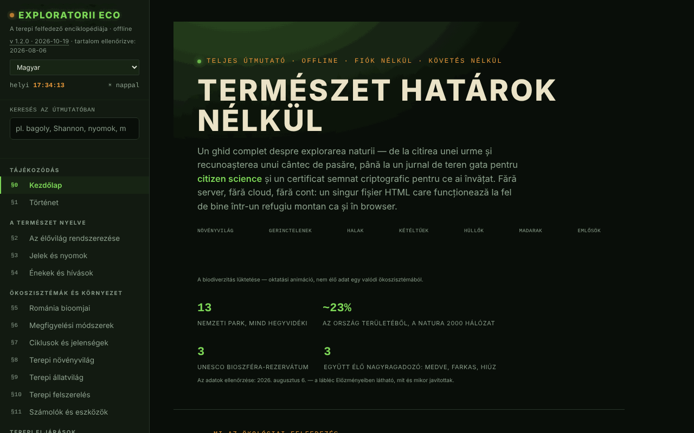

# Exploratorii Eco

[English](README.md) · [Română](README.ro.md) · [Français](README.fr.md) · [Italiano](README.it.md) · [Español](README.es.md) · [Português](README.pt.md) · [Deutsch](README.de.md) · **Magyar**

**Verzió:** 1.2.8 · **Utolsó frissítés:** 2026-10-23

A felület nyelvei: **Română, English, Français, Italiano, Español, Português (PT), Deutsch, Magyar**

A terepi felfedező enciklopédiája: természetismereti útmutató, megfigyelési napló és terepi eszközök egyetlen HTML-fájlban.

**Élő verzió:** https://chiuta.github.io/ExploratoriiEco/

## Mi ez

Teljes útmutató a természet felfedezéséhez, 20 szakaszban (§0–§19): az élővilág rendszerezése, jelek és nyomok, énekek és hívások, Románia biomjai, megfigyelési módszerek, terepi flóra és fauna, felszerelés, számológépek, terepi eljárások, napló és állampolgári tudomány, etika (Leave No Trace), jelvények, vészhelyzetek, védett területek, tudáspróba és A–Z szószedet. A tartalom ismeretterjesztő; fontos döntésekhez (védett területekre való belépés, szigorúan védett fajok, vészhelyzetek) az alkalmazás az ANMAP-ra és a Salvamont Românira mint mértékadó forrásokra hivatkozik.

## Funkciók

- Navigáció szakaszok szerint az oldalmenüből (☰ mobilon); **Éjszaka / Nappal** téma (☾ / ☀ gombok; első megnyitáskor a rendszer beállítását követi).
- **Keresés az útmutatóban** (oldalmenü): a 20 szakasz teljes szövegében keres, ékezetek nélkül (pl. „bufnita”, „Shannon”); szűri a menüt, az Enter megnyitja a legjobban illeszkedő szakaszt, az Esc kiüríti a mezőt.
- **Számológépek és eszközök** (§11): Shannon–Wiener-biodiverzitásindex, Maidenhead-lokátor, azimut és távolság egy célponthoz (élő iránytűvel, ha az eszköz támogatja), a levegő hűlése a magassággal, egy utazás szénlábnyoma, fák szénmegkötése. A számítások helyben, az oldalon történnek.
- **Hívásedző** (§4): szintetizált hangok (nem valódi felvételek) bizonyos minták felismeréséhez, valamint a hangutánzó név felolvasása a böngésző beszédszintézisével, ha elérhető.
- **Terepi napló** (§13): megfigyeléseket adsz hozzá (faj, szám, dátum, idő, hely, viselkedés, jegyzetek), a hely kérésre GPS-ből kitölthető; `.json` export és import, megosztás fájlként. A számláló „nem exportált” értéket mutat az exportálásig, és ha nem exportált megfigyelésekkel hagyod el az oldalt, a böngésző megerősítést kér (a napló csak akkor marad meg a böngészőben, ha bejelölöd a „Napló megtartása ezen az eszközön” négyzetet).
- **Tudáspróba** (§18): véletlenszerű vagy kategóriák szerinti mód, pontszám, kategóriánkénti előrehaladás exporttal/importtal.
- **Helyi azonosság és tanúsítványok**: ECDSA P-256 kulcs generálása a böngészőben, az elsajátított kategóriák önaláírt tanúsítványa (kategóriánként legalább 80% helyes válasz és 5 kérdés), ellenőrzés, „tanú”, visszavonás. Nem hivatalos oklevél.
- **A–Z szószedet** kereséssel és saját jegyzetekkel (export/import).
- A naplóból és a tudáspróbából számított jelvények, amíg az oldal nyitva van.
- **Az aktuális szakasz nyomtatása**, teljes képernyős mód a próbához, „Hiba jelentése” gomb (megnyitja a GitHub issues űrlapot).
- **Fájlintegritás ellenőrzése**: kérésre kiszámítja a kiszolgált fájl SHA-256 értékét.

## Újdonságok (v1.1.0, 2026. október 14.)

Ebben a verzióban nincsenek új tanulási funkciók: **a térközös ismétlés már létezik** (Tudáspróba szakasz, SM-2 exporttal/importtal), és nem lett megkettőzve. Az újdonság az alábbi kit; a biztonsági mentés tartalmazza a **megfigyelési naplót**, ha az eszközön megtartottad (`exploratorii-eco-jurnal-v1`).

### Átláthatóság és biztonsági mentés (fff-kit)

A megjelenített verzióra (`v 1.1.0 · 2026-10-14`) kattintva (vagy Entert nyomva) megnyílik az „Átláthatóság” ablak: a deklarált hálózati gazdák (0 külső kérés), a helyi tárolókulcsok méretekkel, a használt API-k, a fájl mérete és SHA-256 értéke (ellenőrzővel a letöltött fájlhoz), valamint az alkalmazás adatainak **biztonsági mentése** `.fff.json` fájlba (opcionálisan jelszóval titkosítva, AES-GCM 256 / PBKDF2; a jelszó nem állítható vissza), megerősítéssel történő import és az alkalmazás adatainak törlése. A kit (`fff-kit`, modulok: core, label, bundle) be van illesztve az `index.html`-be, nem indít hálózati kéréseket, és nem változtatja meg a meglévő adatokat; nélküle az alkalmazás ugyanúgy működik. A napló helyeket és személyes megfigyeléseket tartalmazhat: a terjesztett fájlokhoz használd a „Titkosított exportálás” lehetőséget. A kit szövegei 8 nyelven vannak (ro, en, fr, it, es, pt, hu, de); **az fr/it/es/pt/hu/de fordítások gépiek, anyanyelvi beszélők nem ellenőrizték őket**. Maga az alkalmazás felülete román marad.

## Használati útmutató

1. Nyisd meg az oldalt, és válassz egy szakaszt a bal oldali menüből.
2. A naplóhoz menj a „§13 Napló & állampolgári tudomány” szakaszra, töltsd ki a mezőket, és nyomd meg a **+ Megfigyelés hozzáadása** gombot; majd a **💾 Exportálás (.json)** gombbal mentsd az adatokat.
3. A napló folytatásához nyomd meg a **📂 Importálás** gombot, és válaszd ki a korábban exportált fájlt.
4. A számológépekhez menj a „§11 Számológépek & eszközök” szakaszra; a „📍 Saját helyem használata” gombok a böngésző helymeghatározási engedélyét kérik.
5. A „§18 Tudáspróba” szakaszban válassz kategóriát, vagy válaszolj közvetlenül; a **💾 Haladás exportálása** és a **📂 Haladás importálása** megőrzi az eredményeket a látogatások között.
6. Tanúsítványhoz: **🔑 Azonosság létrehozása**, majd **📜 Tanúsítvány létrehozása**; exportáld az azonosságot tartalékként.
7. A témát a **☾ Éjszaka / ☀ Nappal** gombbal válthatod; az aktuális szakaszt a **🖨️ Az aktuális szakasz nyomtatása** gombbal nyomtathatod.

## Figyelmeztetés

Ismeretterjesztő/tájékoztató tartalom. A vészhelyzetekről, kígyókról, kullancsokról, gombákról és növényekről szóló szakaszok nem helyettesítenek elsősegély-tanfolyamot, orvosi tanácsot vagy a hatóságokat (112, Salvamont, ANMAP); növényeket és gombákat nem szabad az útmutató alapján fogyasztani. Az alkalmazás a láblécben ennek megfelelő megjegyzést jelenít meg. A létrehozott „tanúsítványok” a saját előrehaladásod önaláírt bizonyítékai, nem hivatalos oklevelek.

## Adatvédelem és hálózat

- **Tárolás:** a `localStorage` egyetlen használata (kulcs: `exploratoriieco.jurnal-v1`) a napló opcionális másolata, amely csak akkor aktív, ha bejelölöd a „Napló megtartása ezen az eszközön” négyzetet; nincs sessionStorage vagy IndexedDB. A napló (jelölés nélkül), a pontszámok, a szószedet jegyzetei és a kriptográfiai azonosság csak a memóriában élnek, és az oldal újratöltésekor eltűnnek, ha nem exportálod őket.
- **Hálózat:** az oldal nem tölt be külső szkripteket, betűtípusokat vagy képeket, és nincs analitikája. Az egyetlen hálózati kérés a felhasználó kérésére történik: a „Fájlintegritás ellenőrzése” gomb újra beolvassa a fájlt arról a címről, ahonnan kiszolgálják. A lábléc hivatkozásai (ANMAP, iNaturalist, GBIF, IUCN, Salvamont, fiipregatit.ro, GitHub, TROM) csak kattintásra nyílnak meg.
- A böngészőengedélyeket csak művelet közben kéri: helymeghatározás (GPS), tájolás/iránytű, beszédszintézis, fájlmegosztás.

## Helyi / offline futtatás

Töltsd le az `index.html` fájlt, és nyisd meg egy böngészőben. Az alkalmazás internet nélkül működik; az integritásellenőrzést a böngésző blokkolhatja a közvetlenül lemezről megnyitott fájloknál (ilyenkor az alkalmazás üzenetet jelenít meg).

## Licenc

MIT — lásd a `LICENSE` fájlt. © 2026 Alexandru-Ionuț Chiuță (Alexio). A fájlba esetleg beépített harmadik féltől származó könyvtárak megtartják saját licencüket.

## Audit

Audit: 2026-10-10 — Playwrighttal és axe-core-ral ellenőrizve (mind a 20 szakasz, mindkét téma); nincs `localStorage`; a napló és az import `` mintával tesztelve (kikerülve). Javítva: láthatatlan címsorok a „Nappal” témában (fehér szöveg világos háttéren), kontraszt, érvénytelen definíciólista a szószedetben.

## Előzmények / Changelog

### 1.2.8 — 2026-10-23
- A tárolókulcsok mostantól az alkalmazás előtagját viselik (`exploratoriieco.lang`, `exploratoriieco.jurnal-v1`); a meglévő adatok (nyelv, a napló opcionális másolata) indításkor automatikusan átkerülnek, a régi `.fff.json` másolatok továbbra is importálhatók.
- fff-kit 1.2.0: előtag nélküli tárolás javítva
- A natív alert/confirm/prompt ablakokat akadálymentes, lefordított FFF.dialog párbeszédablakok váltották fel (fff-kit 1.2.0).

### 1.2.6 — 2026-10-22

fff-kit 1.1.4: érintési célok és minimális szövegméret. Érintési célok/szöveg javítva az alkalmazásban.

### 1.2.5 — 2026-10-22

fff-kit 1.1.2: PBKDF2 600 000 iterációval, clickjacking elleni védelem.

### 1.2.4 — 2026-10-22
- A hét blokkoló böngészőablakot (azonosító-, helymeghatározási és tesztvisszaállítási riasztások, valamint a megerősítés) lefordított modális ablakok váltják fel (8 nyelv).
- Akadálymentesség: oldalanként pontosan egy H1 van (a vizuálisan rejtett címsor mindig elérhető; a díszítő hős-cím rejtve van a képernyőolvasók elől); a nyolc fájlimportáló mező a képernyőolvasók által felolvasott névvel rendelkezik.
- A hős-cím dekódoló animációja legfeljebb 0,7 másodpercig tart valós időben (lassú eszközökön olvashatatlan maradt), a cím pedig világos témában megfelelő kontrasztú (sötét tinta).
- Mobil: a kis szöveg (lábléc, jelentéshivatkozások, hős-feliratok, témagombok) legalább 12 px.

### 1.2.3 — 2026-10-22
- Fordítási javítás: az átláthatósági panel leírása (és neve) mostantól a felület nyelvét követi.

### 1.2.2 — 2026-10-22
- Fordítási javítás: a hívásgyakorló énekleírásai, az oldal címe és az alkalmazáson belüli előzmények mostantól a felület nyelvét követik.

- v1.1.0 — 2026-10-14: fff-kit (Átláthatóság + egységes biztonsági mentés, a naplót is beleértve). A tartalom és a térközös ismétlés nem változott.

- 1.0.4 — 2026-10-12: a verzió és az utolsó frissítés dátuma megjelenik az alkalmazásban (a ténybeli tartalmat utoljára 2026-08-06-án ellenőrizték; az ANANP → ANMAP átszervezést 2026. 10. 11-én webes kereséssel újra megerősítették).
- v1.0.3: **a napló opcionális megtartása az eszközön** (jelölőnégyzet a §13-ban, alapértelmezetten kikapcsolva; `localStorage`, kulcs: `exploratorii-eco-jurnal-v1`, figyelmeztetéssel megosztott eszközökre; a jelölés törlése törli a másolatot; aktív állapotban az oldal elhagyásakor megjelenő figyelmeztetés már nem jelenik meg); **a napló importja kihagyja a már meglévő azonos megfigyeléseket** (újraimportáláskor nem duplikál többé). A CSP-hash újraszámítva; axe-core = 0 szabálysértés 1280 és 360 px mellett.
- v1.0.2: keresés a teljes útmutatóban; figyelmeztetés az oldal elhagyásakor nem exportált megfigyeléseknél (+ „nem exportált/exportált” jelző a naplóban); a kezdeti téma a `prefers-color-scheme` beállítást követi. A CSP-hash újraszámítva; axe-core = 0 szabálysértés 1280 és 360 px mellett, mindkét témában.
- v1.0.1: a Shannon–Wiener-számológép előre kitöltött példával indul (bükk, jegenyefenyő, lucfenyő, gyertyán, hegyi juhar), és az H′ értéket az elejétől mutatja.
- A nyitóképernyő kategóriasávja mobilon törik (a címkék már nem tapadnak össze); a kezdőoldal margói keskeny képernyőn 20 px-re csökkentek.
- A felső sáv `<header>`, a lábléc címsorai h2-k; CSP-szabályzat került be (`connect-src 'self'` az integritásellenőrzéshez). axe-core = 0 szabálysértés 1280 és 360 px mellett.

## Szerző

Alexio — Alexandru-Ionuț Chiuță. Az alkalmazás a láblécből a Centrul STRING-re (CSPCF) hivatkozik. Elérhetőség: alexio@trom.tf

## Összefoglaló

Az Exploratorii Eco egyfájlos, román nyelvű terepi természetbúvár-enciklopédia: 20 szakasz, számológépek (Shannon–Wiener-index, Maidenhead-lokátor, azimut, hőmérsékleti gradiens, szén), terepi napló JSON-exporttal/-importtal, kvíz, valamint helyben létrehozott aláírt tanúsítványok (ECDSA). Nem használ böngészőtárolót (az állapot újratöltéskor elvész, ha nem exportálják), és nem indít hálózati kéréseket, kivéve egy opcionális fájlintegritás-ellenőrzést. MIT licenc alatt.
