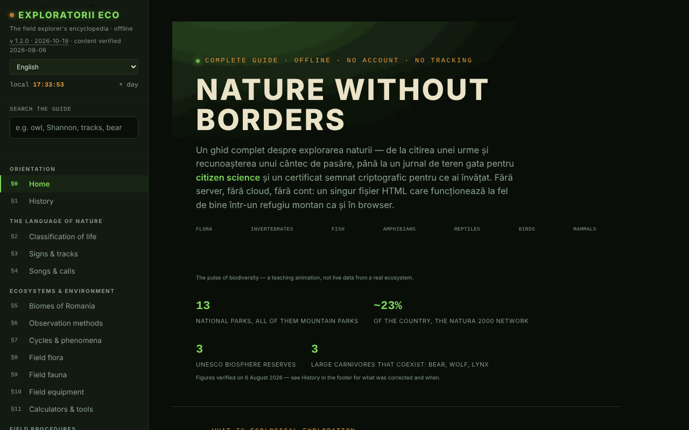

# Exploratorii Eco

**English** · [Română](README.ro.md) · [Français](README.fr.md) · [Italiano](README.it.md) · [Español](README.es.md) · [Português](README.pt.md) · [Deutsch](README.de.md) · [Magyar](README.hu.md)

**Version:** 1.2.8 · **Last updated:** 2026-10-23

Interface languages: **Română, English, Français, Italiano, Español, Português (PT), Deutsch, Magyar**

The field explorer's encyclopedia: a nature guide, an observation journal and field tools in a single HTML file.

**Live:** https://chiuta.github.io/ExploratoriiEco/

## What it is

A complete guide to exploring nature, in 20 sections (§0–§19): classification of life, signs and tracks, songs and calls, the biomes of Romania, observation methods, field flora and fauna, equipment, calculators, field procedures, journal and citizen science, ethics (Leave No Trace), badges, emergencies, protected areas, a knowledge quiz and an A–Z glossary. The content is educational; for important decisions (access to protected areas, strictly protected species, emergencies) the app refers to ANMAP and Salvamont România as authoritative sources.

## Features

- Navigation by section from the side menu (☰ on mobile); **Night / Day** theme (the ☾ / ☀ buttons; on first opening it follows the system preference).
- **Guide search** (side menu): searches the full text of the 20 sections, without diacritics (e.g. "bufnita", "Shannon"); it filters the menu, Enter opens the best-matching section, Esc clears the field.
- **Calculators and tools** (§11): Shannon–Wiener biodiversity index, Maidenhead locator, bearing and distance to a target (with a live compass, if the device supports it), air cooling with altitude, the carbon footprint of a trip, carbon sequestration for trees. The calculations are done locally, in the page.
- **Call trainer** (§4): synthesized tones (not real recordings) for recognizing certain patterns, plus reading the onomatopoeic name aloud through the browser's speech synthesis, if available.
- **Field journal** (§13): you add observations (species, count, date, time, place, behaviour, notes), with the place filled in from GPS on request; `.json` export and import, sharing as a file. The counter shows "unexported" until exported, and when leaving the page with unexported observations the browser asks for confirmation (the journal is not kept in the browser unless you tick "Keep the journal on this device").
- **Knowledge quiz** (§18): random mode or by category, score, progress by category with export/import.
- **Local identity and certificates**: generation of an ECDSA P-256 key in the browser, a self-signed certificate of the mastered categories (at least 80% correct and 5 questions per category), verification, "witness", revocation. It is not an official diploma.
- **A–Z glossary** with search and your own notes (export/import).
- Badges computed from the journal and from the knowledge quiz, while the page is open.
- **Print the current section**, full-screen mode for the quiz, a "Report an error" button (opens the GitHub issues form).
- **Check file integrity**: on request, it computes the SHA-256 of the served file.

## New features (v1.1.0, 14 October 2026)

No new learning features in this version: **spaced repetition already exists** (the Knowledge quiz section, SM-2 with export/import) and was not duplicated. The addition is the kit below; the backup includes the **observation journal** if you kept it on the device (`exploratorii-eco-jurnal-v1`).

### Transparency and backup (fff-kit)

A click (or Enter) on the displayed version (`v 1.1.0 · 2026-10-14`) opens the "Transparency" window: the declared network hosts (0 external requests), the local storage keys with sizes, the APIs used, the size and SHA-256 of the file (with a verifier for a downloaded file) and the **backup** of the app's data to a `.fff.json` file (optionally encrypted with a password, AES-GCM 256 / PBKDF2; the password cannot be recovered), import with confirmation and deletion of the app's data. The kit (`fff-kit`, modules: core, label, bundle) is pasted into `index.html`, makes no network requests and does not change existing data; without it the app works the same. The journal may contain locations and personal observations: use "Export encrypted" for files that circulate. The kit's texts are in 8 languages (ro, en, fr, it, es, pt, hu, de); **the fr/it/es/pt/hu/de translations are machine-generated and not checked by native speakers**. The app's own interface remains in Romanian.

## User guide

1. Open the page and choose a section from the menu on the left.
2. For the journal, go to "§13 Journal & citizen science", fill in the fields and press **+ Add observation**; then **💾 Export (.json)** to keep the data.
3. To resume the journal, press **📂 Import** and choose the file exported earlier.
4. For the calculators, go to "§11 Calculators & tools"; the "📍 Use my location" buttons ask for the browser's location permission.
5. In "§18 Knowledge quiz" choose a category or answer directly; **💾 Export progress** and **📂 Import progress** keep the results between visits.
6. For a certificate: **🔑 Generate identity**, then **📜 Generate certificate**; export the identity as a backup.
7. Change the theme with **☾ Night / ☀ Day**; print the current section with **🖨️ Print the current section**.

## Warning

Educational/indicative content. The sections on emergencies, snakes, ticks, mushrooms and plants do not replace a first-aid course, medical advice or the authorities (112, Salvamont, ANMAP); plants and mushrooms must not be eaten on the basis of the guide. The app displays a note to the same effect in the footer. The "certificates" generated are self-signed proofs of your own progress, not official diplomas.

## Privacy and network

- **Storage:** the only use of `localStorage` (key `exploratoriieco.jurnal-v1`) is the optional copy of the journal, active only if you tick "Keep the journal on this device"; no sessionStorage or IndexedDB. The journal (without the tick), the scores, the glossary notes and the cryptographic identity live only in memory and disappear when the page is reloaded, unless you export them.
- **Network:** the page loads no external scripts, fonts or images and has no analytics. The only network request is on the user's request: the "Check file integrity" button re-reads the file from the address it is served from. The footer links (ANMAP, iNaturalist, GBIF, IUCN, Salvamont, fiipregatit.ro, GitHub, TROM) open only on click.
- Browser permissions requested only on action: location (GPS), orientation/compass, speech synthesis, file sharing.

## Local / offline use

Download `index.html` and open it in a browser. The app works without internet; the integrity check may be blocked by the browser for files opened directly from disk (the app shows a message in that case).

## License

MIT — see the `LICENSE` file. © 2026 Alexandru-Ionuț Chiuță (Alexio). Any third-party libraries included in the file keep their own licenses.

## Audit

Audit: 2026-10-10 — verified with Playwright and axe-core (all 20 sections, both themes); no `localStorage`; the journal and the import tested with `` (escaped). Fixed: invisible headings in the "Day" theme (white text on a light background), contrast, an invalid definition list in the glossary.

## History / Changelog

### 1.2.8 — 2026-10-23
- Storage keys now carry the app prefix (`exploratoriieco.lang`, `exploratoriieco.jurnal-v1`); existing data (language, optional journal copy) is migrated automatically at startup, and old `.fff.json` copies can still be imported.
- fff-kit 1.2.0: unprefixed-storage fixed
- Native alert/confirm/prompt replaced with accessible, translated FFF.dialog dialogs (fff-kit 1.2.0).

### 1.2.6 — 2026-10-22

fff-kit 1.1.4: touch targets and minimum text size. Touch targets/text fixed in the app.

### 1.2.5 — 2026-10-22

fff-kit 1.1.2: PBKDF2 with 600,000 iterations, anti-clickjacking protection.

### 1.2.4 — 2026-10-22
- The seven blocking browser dialogs (identity, geolocation and quiz-reset alerts and confirmation) are replaced by translated modal dialogs (8 languages).
- Accessibility: exactly one H1 per page (the visually hidden heading is always exposed; the decorative hero title is hidden from screen readers); the eight import file fields have names announced by screen readers.
- The hero title decode animation now lasts at most 0.7 s of real time (it stayed garbled on slow devices) and the title has sufficient contrast (dark ink) in the light theme.
- Mobile: small text (footer, report links, hero labels, theme buttons) is at least 12 px.

### 1.2.3 — 2026-10-22
- Translation fix: the description (and name) in the transparency panel now follow the interface language.

### 1.2.2 — 2026-10-22
- Translation fix: the bird-song descriptions in the call trainer, the page title and the in-app history now follow the interface language.

- v1.1.0 — 2026-10-14: fff-kit (Transparency + unified backup, including the journal). The content and the spaced repetition did not change.

- 1.0.4 — 2026-10-12: the version and the date of the last update are shown in the app (factual content last verified on 2026-08-06; the ANANP → ANMAP reorganization reconfirmed by a web search on 11.10.2026).
- v1.0.3: **optional keeping of the journal on the device** (checkbox in §13, disabled by default; `localStorage`, key `exploratorii-eco-jurnal-v1`, with a warning for shared devices; unticking deletes the copy; when active, the leave-page warning no longer appears); **the journal import skips identical observations already present** (no more duplicating on re-import). CSP hash recalculated; axe-core = 0 violations at 1280 and 360 px.
- v1.0.2: search across the whole guide; a warning when leaving the page with unexported observations (+ an "unexported/exported" indicator in the journal); the initial theme follows `prefers-color-scheme`. CSP hash recalculated; axe-core = 0 violations at 1280 and 360 px, in both themes.
- v1.0.1: the Shannon–Wiener calculator starts with a pre-filled example (beech, fir, spruce, hornbeam, sycamore maple) and shows H′ from the start.
- The category bar in the hero wraps on mobile (the labels no longer stick together); the start page margins are reduced to 20 px on narrow screens.
- The top bar is a `<header>`, the footer headings are h2; a CSP policy was added (`connect-src 'self'` for the integrity check). axe-core = 0 violations at 1280 and 360 px.

## Author

Alexio — Alexandru-Ionuț Chiuță. From the footer, the app links to Centrul STRING (CSPCF). Contact: alexio@trom.tf

## Summary

Exploratorii Eco is a single-file Romanian-language field naturalist's encyclopedia: 20 sections, calculators (Shannon–Wiener index, Maidenhead locator, bearing, lapse rate, carbon), a field journal with JSON export/import, a quiz, and locally generated signed certificates (ECDSA). It uses no browser storage (state is lost on reload unless exported) and makes no network requests except an optional file-integrity check. Licensed under MIT.
