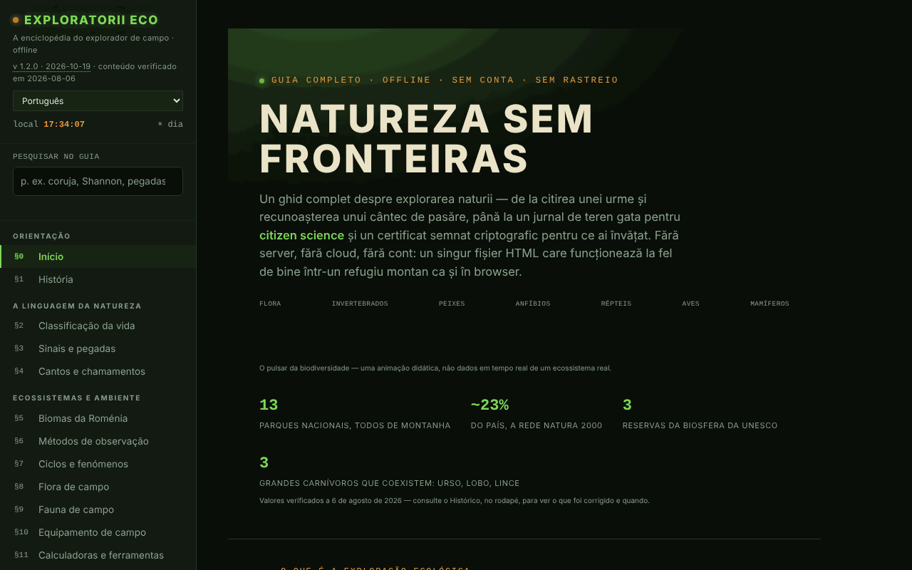

# Exploratorii Eco

[English](README.md) · [Română](README.ro.md) · [Français](README.fr.md) · [Italiano](README.it.md) · [Español](README.es.md) · **Português** · [Deutsch](README.de.md) · [Magyar](README.hu.md)

**Versão:** 2.0.0 · **Última atualização:** 2026-10-26

Idiomas da interface: **Română, English, Français, Italiano, Español, Português (PT), Deutsch, Magyar**

A enciclopédia do explorador de campo: guia da natureza, diário de observações e ferramentas de campo num único ficheiro HTML.

**Online:** https://chiuta.github.io/ExploratoriiEco/

## O que é

Um guia completo para explorar a natureza, em 20 secções (§0–§19): classificação da vida, sinais e pegadas, cantos e chamamentos, biomas da Roménia, métodos de observação, flora e fauna de campo, equipamento, calculadoras, procedimentos de campo, diário e ciência cidadã, ética (Leave No Trace), emblemas, emergências, áreas protegidas, teste de conhecimentos e glossário A–Z. O conteúdo é educativo; para decisões importantes (acesso a áreas protegidas, espécies estritamente protegidas, emergências), a aplicação remete para a ANMAP e a Salvamont România como fontes de referência.

## Funcionalidades

- Navegação por secções a partir do menu lateral (☰ no telemóvel); tema **Noite / Dia** (botões ☾ / ☀; na primeira abertura segue a preferência do sistema).
- **Pesquisa no guia** (menu lateral): pesquisa no texto integral das 20 secções, sem diacríticos (p. ex., «bufnita», «Shannon»); filtra o menu, Enter abre a secção mais relevante, Esc limpa o campo.
- **Calculadoras e ferramentas** (§11): índice de biodiversidade de Shannon–Wiener, locator Maidenhead, azimute e distância até um alvo (com bússola em direto, se o dispositivo o permitir), arrefecimento do ar com a altitude, pegada de carbono de uma deslocação, sequestro de carbono pelas árvores. Os cálculos são feitos localmente, na página.
- **Treinador de chamamentos** (§4): tons sintetizados (não gravações reais) para reconhecer certos padrões, além da leitura em voz alta do nome onomatopaico através da síntese de voz do navegador, se estiver disponível.
- **Diário de campo** (§13): acrescenta observações (espécie, número, data, hora, local, comportamento, notas), com o local preenchido a partir do GPS a pedido; exportação e importação `.json`, partilha como ficheiro. O contador mostra «não exportado» até à exportação, e ao sair da página com observações não exportadas o navegador pede confirmação (o diário não é guardado no navegador, a menos que assinale «Manter o diário neste dispositivo»).
- **Teste de conhecimentos** (§18): modo aleatório ou por categorias, pontuação, progresso por categoria com exportação/importação.
- **Identidade local e certificados**: geração de uma chave ECDSA P-256 no navegador, certificado autoassinado das categorias dominadas (mínimo de 80% de respostas certas e 5 perguntas por categoria), verificação, «testemunha», revogação. Não é um diploma oficial.
- **Glossário A–Z** com pesquisa e notas próprias (exportação/importação).
- Emblemas calculados a partir do diário e do teste de conhecimentos, enquanto a página estiver aberta.
- **Imprimir a secção atual**, modo de ecrã inteiro para o teste, botão «Comunicar um erro» (abre o formulário de issues do GitHub).
- **Verificar a integridade do ficheiro**: a pedido, calcula o SHA-256 do ficheiro servido.

## Novidades (v1.1.0, 14 de outubro de 2026)

Sem novas funcionalidades de aprendizagem nesta versão: **a repetição espaçada já existe** (secção Teste de conhecimentos, SM-2 com exportação/importação) e não foi duplicada. O acréscimo é o kit abaixo; a cópia de segurança inclui **o diário de observações** se o tiver guardado no dispositivo (`exploratorii-eco-jurnal-v1`).

### Transparência e cópia de segurança (fff-kit)

Um clique (ou Enter) na versão apresentada (`v 1.1.0 · 2026-10-14`) abre a janela «Transparência»: os anfitriões de rede declarados (0 pedidos externos), as chaves de armazenamento local com os tamanhos, as APIs usadas, o tamanho e o SHA-256 do ficheiro (com um verificador para um ficheiro descarregado) e a **cópia de segurança** dos dados da aplicação num ficheiro `.fff.json` (opcionalmente cifrado com palavra-passe, AES-GCM 256 / PBKDF2; a palavra-passe não pode ser recuperada), a importação com confirmação e a eliminação dos dados da aplicação. O kit (`fff-kit`, módulos: core, label, bundle) está colado no `index.html`, não faz pedidos de rede e não altera os dados existentes; sem ele a aplicação funciona da mesma forma. O diário pode conter localizações e observações pessoais: use «Exportar cifrado» para os ficheiros que circulem. Os textos do kit estão em 8 idiomas (ro, en, fr, it, es, pt, hu, de); **as traduções fr/it/es/pt/hu/de são automáticas e não verificadas por falantes nativos**. A interface da própria aplicação continua em romeno.

## Manual de utilização

1. Abra a página e escolha uma secção no menu da esquerda.
2. Para o diário, vá a «§13 Diário & ciência cidadã», preencha os campos e prima **+ Adicionar observação**; depois **💾 Exportar (.json)** para guardar os dados.
3. Para retomar o diário, prima **📂 Importar** e escolha o ficheiro exportado anteriormente.
4. Para as calculadoras, vá a «§11 Calculadoras & ferramentas»; os botões «📍 Usar a minha localização» pedem a permissão de localização do navegador.
5. Em «§18 Teste de conhecimentos» escolha uma categoria ou responda diretamente; **💾 Exportar o progresso** e **📂 Importar o progresso** guardam os resultados entre visitas.
6. Para um certificado: **🔑 Gerar identidade**, depois **📜 Gerar certificado**; exporte a identidade como reserva.
7. Mude o tema com **☾ Noite / ☀ Dia**; imprima a secção atual com **🖨️ Imprimir a secção atual**.

## Aviso

Conteúdo educativo/orientativo. As secções sobre emergências, cobras, carraças, cogumelos e plantas não substituem um curso de primeiros socorros, o aconselhamento médico ou as autoridades (112, Salvamont, ANMAP); as plantas e os cogumelos não se consomem com base no guia. A aplicação apresenta uma nota nesse sentido no rodapé. Os «certificados» gerados são provas autoassinadas do seu próprio progresso, não diplomas oficiais.

## Privacidade e rede

- **Armazenamento:** a única utilização de `localStorage` (chave `exploratoriieco.jurnal-v1`) é a cópia opcional do diário, ativa apenas se assinalar «Manter o diário neste dispositivo»; sem sessionStorage nem IndexedDB. O diário (sem a marca), as pontuações, as notas do glossário e a identidade criptográfica ficam apenas em memória e desaparecem ao recarregar a página, a menos que os exporte.
- **Rede:** a página não carrega scripts, tipos de letra ou imagens externos e não tem análise de utilização. O único pedido de rede é feito a pedido do utilizador: o botão «Verificar a integridade do ficheiro» volta a ler o ficheiro a partir do endereço de onde é servido. As ligações do rodapé (ANMAP, iNaturalist, GBIF, IUCN, Salvamont, fiipregatit.ro, GitHub, TROM) só se abrem ao clicar.
- Permissões do navegador pedidas apenas na ação: localização (GPS), orientação/bússola, síntese de voz, partilha de ficheiros.

## Utilização local / offline

Descarregue `index.html` e abra-o num navegador. A aplicação funciona sem internet; a verificação de integridade pode ser bloqueada pelo navegador para ficheiros abertos diretamente do disco (a aplicação apresenta uma mensagem nesse caso).

## Licença

MIT — consulte o ficheiro `LICENSE`. © 2026 Alexandru-Ionuț Chiuță (Alexio). Eventuais bibliotecas de terceiros incluídas no ficheiro mantêm as suas próprias licenças.

## Auditoria

Auditoria: 2026-10-10 — verificado com Playwright e axe-core (as 20 secções, ambos os temas); sem `localStorage`; o diário e a importação testados com `` (escapado). Corrigidos: títulos invisíveis no tema «Dia» (texto branco em fundo claro), contraste, lista de definições inválida no glossário.

## Histórico / Changelog

### 1.2.9 — 2026-10-23

- Fix: spaced-repetition progress import now validates numeric fields (ef/reps/interval/due) and caps correct ≤ answered; CSP hash recalculated.

### 1.2.8 — 2026-10-23
- As chaves de armazenamento têm agora o prefixo da aplicação (`exploratoriieco.lang`, `exploratoriieco.jurnal-v1`); os dados existentes (idioma, cópia opcional do diário) são migrados automaticamente no arranque e as cópias antigas `.fff.json` continuam a poder ser importadas.
- fff-kit 1.2.0: armazenamento sem prefixo corrigido
- As caixas nativas alert/confirm/prompt foram substituídas por diálogos FFF.dialog acessíveis e traduzidos (fff-kit 1.2.0).

### 1.2.6 — 2026-10-22

fff-kit 1.1.4: áreas de toque e texto mínimo. Áreas de toque/texto corrigidos na aplicação.

### 1.2.5 — 2026-10-22

fff-kit 1.1.2: PBKDF2 com 600.000 iterações, proteção anti-clickjacking.

### 1.2.4 — 2026-10-22
- As sete caixas de diálogo bloqueantes do navegador (alertas de identidade, geolocalização e reposição do teste, mais a confirmação) são substituídas por diálogos modais traduzidos (8 idiomas).
- Acessibilidade: exatamente um H1 por página (o título oculto visualmente é sempre exposto; o título decorativo do hero é ocultado dos leitores de ecrã); os oito campos de importação de ficheiros têm um nome anunciado pelos leitores de ecrã.
- A animação de descodificação do título do hero dura no máximo 0,7 s em tempo real (em dispositivos lentos ficava ilegível) e o título tem contraste suficiente (tinta escura) no tema claro.
- Móvel: o texto pequeno (rodapé, ligações de relatório, etiquetas do hero, botões de tema) tem pelo menos 12 px.

### 1.2.3 — 2026-10-22
- Correção de tradução: a descrição (e o nome) do painel de transparência seguem agora o idioma da interface.

### 1.2.2 — 2026-10-22
- Correção de tradução: as descrições dos cantos no treinador de chamamentos, o título da página e o histórico da aplicação seguem agora o idioma da interface.

- v1.1.0 — 2026-10-14: fff-kit (Transparência + cópia de segurança unificada, incluindo o diário). O conteúdo e a repetição espaçada não mudaram.

- 1.0.4 — 2026-10-12: a versão e a data da última atualização são apresentadas na aplicação (conteúdo factual verificado pela última vez em 2026-08-06; a reorganização ANANP → ANMAP reconfirmada por pesquisa na web em 11.10.2026).
- v1.0.3: **manutenção opcional do diário no dispositivo** (caixa em §13, desativada por predefinição; `localStorage`, chave `exploratorii-eco-jurnal-v1`, com aviso para dispositivos partilhados; desmarcá-la elimina a cópia; quando ativa, o aviso ao sair da página deixa de aparecer); **a importação do diário ignora as observações idênticas já presentes** (deixa de duplicar ao reimportar). Hash CSP recalculado; axe-core = 0 violações a 1280 e 360 px.
- v1.0.2: pesquisa em todo o guia; aviso ao sair da página com observações não exportadas (+ indicador «não exportado/exportado» no diário); o tema inicial segue `prefers-color-scheme`. Hash CSP recalculado; axe-core = 0 violações a 1280 e 360 px, nos dois temas.
- v1.0.1: a calculadora de Shannon–Wiener arranca com um exemplo pré-preenchido (faia, abeto, espruce, carpino, bordo-sicómoro) e mostra H′ desde o início.
- A barra de categorias do hero quebra linha no telemóvel (as etiquetas deixam de se colar); as margens da página inicial são reduzidas para 20 px em ecrãs estreitos.
- A barra superior é um `<header>`, os títulos do rodapé são h2; foi acrescentada uma política CSP (`connect-src 'self'` para a verificação de integridade). axe-core = 0 violações a 1280 e 360 px.

## Autor

Alexio — Alexandru-Ionuț Chiuță. A partir do rodapé, a aplicação remete para o Centrul STRING (CSPCF). Contacto: alexio@trom.tf

## Resumo

O Exploratorii Eco é uma enciclopédia do naturalista de campo em romeno, num único ficheiro: 20 secções, calculadoras (índice de Shannon–Wiener, locator Maidenhead, azimute, gradiente térmico, carbono), um diário de campo com exportação/importação JSON, um teste e certificados assinados gerados localmente (ECDSA). Não usa armazenamento do navegador (o estado perde-se ao recarregar, a menos que seja exportado) e não faz pedidos de rede, exceto uma verificação opcional da integridade do ficheiro. Licenciada sob MIT.
