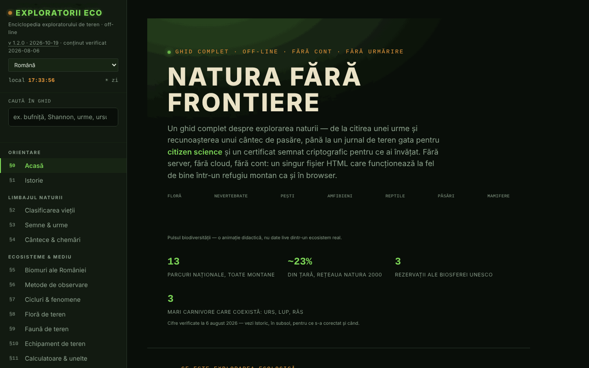

# Exploratorii Eco

[English](README.md) · **Română** · [Français](README.fr.md) · [Italiano](README.it.md) · [Español](README.es.md) · [Português](README.pt.md) · [Deutsch](README.de.md) · [Magyar](README.hu.md)

**Versiune:** 1.2.3 · **Ultima actualizare:** 2026-10-22

Limbile interfeței: **Română, English, Français, Italiano, Español, Português (PT), Deutsch, Magyar**

Enciclopedia exploratorului de teren: ghid de natură, jurnal de observații și unelte de teren într-un singur fișier HTML.

**Live:** https://chiuta.github.io/ExploratoriiEco/

## Ce este

Un ghid complet pentru explorarea naturii, în 20 de secțiuni (§0–§19): clasificarea vieții, semne și urme, cântece și chemări, biomuri ale României, metode de observare, floră și faună de teren, echipament, calculatoare, proceduri de teren, jurnal și citizen science, etică (Leave No Trace), insigne, urgențe, arii protejate, test de cunoștințe și glosar A–Z. Conținutul este educațional; pentru decizii importante (acces în arii protejate, specii strict protejate, urgențe) aplicația trimite la ANMAP și Salvamont România ca surse autoritare.

## Funcții

- Navigare pe secțiuni din meniul lateral (☰ pe mobil); temă **Noapte / Zi** (butoanele ☾ / ☀; la prima deschidere urmează preferința sistemului).
- **Căutare în ghid** (meniul lateral): caută în textul integral al celor 20 de secțiuni, fără diacritice (ex. „bufnita”, „Shannon”); filtrează meniul, Enter deschide secțiunea cea mai potrivită, Esc golește câmpul.
- **Calculatoare și unelte** (§11): indice de biodiversitate Shannon–Wiener, locator Maidenhead, azimut și distanță spre o țintă (cu busolă live, dacă dispozitivul o permite), răcirea aerului cu altitudinea, amprenta de carbon a unei deplasări, sechestrare de carbon pentru copaci. Calculele se fac local, în pagină.
- **Antrenor de chemări** (§4): tonuri sintetizate (nu înregistrări reale) pentru recunoașterea unor tipare, plus citirea cu voce a denumirii onomatopeice prin sinteza vocală a browserului, dacă este disponibilă.
- **Jurnal de teren** (§13): adaugi observații (specie, număr, dată, oră, loc, comportament, note), cu completare a locului din GPS la cerere; export și import `.json`, partajare ca fișier. Contorul arată „neexportat” până la export, iar la părăsirea paginii cu observații neexportate browserul cere confirmare (jurnalul nu se păstrează în browser decât dacă bifezi „Păstrează jurnalul pe acest dispozitiv”).
- **Test de cunoștințe** (§18): mod aleator sau pe categorii, scor, progres pe categorii cu export/import.
- **Identitate locală și certificate**: generare de cheie ECDSA P-256 în browser, certificat auto-semnat al categoriilor stăpânite (minimum 80% corect și 5 întrebări pe categorie), verificare, „martor”, revocare. Nu este o diplomă oficială.
- **Glosar A–Z** cu căutare și notițe proprii (export/import).
- Insigne calculate din jurnal și din testul de cunoștințe, cât timp pagina este deschisă.
- **Printează secțiunea curentă**, mod ecran complet pentru test, buton „Raportează o eroare” (deschide formularul de issues GitHub).
- **Verifică integritatea fișierului**: la cerere, calculează SHA-256 al fișierului servit.

## Funcții noi (v1.1.0, 14 octombrie 2026)

Fără funcții de învățare noi în această versiune: **repetiția spațiată există deja** (secțiunea Test cunoștințe, SM-2 cu export/import) și nu a fost dublată. Adăugirea este kitul de mai jos; copia de siguranță include **jurnalul de observații** dacă l-ai păstrat pe dispozitiv (`exploratorii-eco-jurnal-v1`).

### Transparență și copie de siguranță (fff-kit)

Un clic (sau Enter) pe versiunea afișată (`v 1.1.0 · 2026-10-14`) deschide fereastra „Transparență”: gazdele de rețea declarate (0 cereri externe), cheile de stocare locală cu dimensiuni, API-urile folosite, mărimea și SHA-256 al fișierului (cu verificator pentru un fișier descărcat) și **copia de siguranță** a datelor aplicației într-un fișier `.fff.json` (opțional criptat cu parolă, AES-GCM 256 / PBKDF2; parola nu poate fi recuperată), import cu confirmare și ștergerea datelor aplicației. Kitul (`fff-kit`, module: core, label, bundle) este lipit în `index.html`, nu face cereri de rețea și nu schimbă datele existente; fără el aplicația funcționează la fel. Jurnalul poate conține localizări și observații personale: folosește „Exportă criptat” pentru fișiere care circulă. Textele kitului sunt în 8 limbi (ro, en, fr, it, es, pt, hu, de); **traducerile fr/it/es/pt/hu/de sunt automate și neverificate nativ**. Interfața aplicației însăși rămâne în română.

## Manual de utilizare

1. Deschide pagina și alege o secțiune din meniul din stânga.
2. Pentru jurnal, mergi la „§13 Jurnal & citizen science”, completează câmpurile și apasă **+ Adaugă observație**; apoi **💾 Exportă (.json)** pentru a păstra datele.
3. Pentru a relua jurnalul, apasă **📂 Importă** și alege fișierul exportat anterior.
4. Pentru calculatoare, mergi la „§11 Calculatoare & unelte”; butoanele „📍 Folosește locația mea” cer permisiunea de localizare a browserului.
5. La „§18 Test cunoștințe” alege o categorie sau răspunde direct; **💾 Exportă progresul** și **📂 Importă progresul** păstrează rezultatele între vizite.
6. Pentru un certificat: **🔑 Generează identitate**, apoi **📜 Generează certificat**; exportă identitatea ca rezervă.
7. Schimbă tema cu **☾ Noapte / ☀ Zi**; imprimă secțiunea curentă cu **🖨️ Printează secțiunea curentă**.

## Avertisment

Conținut educațional/orientativ. Secțiunile despre urgențe, șerpi, căpușe, ciuperci și plante nu înlocuiesc un curs de prim ajutor, sfatul medical sau autoritățile (112, Salvamont, ANMAP); plantele și ciupercile nu se consumă pe baza ghidului. Aplicația afișează o notă în același sens în subsol. „Certificatele" generate sunt dovezi auto-semnate ale progresului propriu, nu diplome oficiale.

## Confidențialitate și rețea

- **Stocare:** singura utilizare a `localStorage` (cheia `exploratorii-eco-jurnal-v1`) este copia opțională a jurnalului, activă doar dacă bifezi „Păstrează jurnalul pe acest dispozitiv”; fără sessionStorage sau IndexedDB. Jurnalul (fără bifă), scorurile, notițele din glosar și identitatea criptografică stau doar în memorie și dispar la reîncărcarea paginii, dacă nu le exporți.
- **Rețea:** pagina nu încarcă scripturi, fonturi sau imagini externe și nu are analytics. Singura cerere de rețea este la cererea utilizatorului: butonul „Verifică integritatea fișierului” re-citește fișierul de la adresa de unde este servit. Linkurile din subsol (ANMAP, iNaturalist, GBIF, IUCN, Salvamont, fiipregatit.ro, GitHub, TROM) se deschid doar la clic.
- Permisiuni ale browserului cerute doar la acțiune: localizare (GPS), orientare/busolă, sinteză vocală, partajare de fișiere.

## Rulare locală / offline

Descarcă `index.html` și deschide-l în browser. Aplicația funcționează fără internet; verificarea integrității poate fi blocată de browser pentru fișiere deschise direct de pe disc (aplicația afișează un mesaj în acest caz).

## Licență

MIT — vezi fișierul `LICENSE`. © 2026 Alexandru-Ionuț Chiuță (Alexio). Eventualele biblioteci terțe incluse în fișier își păstrează licențele proprii.

## Audit

Audit: 2026-10-10 — verificat cu Playwright și axe-core (toate cele 20 de secțiuni, ambele teme); fără `localStorage`; jurnalul și importul testate cu `` (escapat). Corectate: titluri invizibile în tema „Zi" (text alb pe fundal deschis), contrast, listă de definiții invalidă în glosar.

## Istoric / Changelog
### 1.2.3 — 2026-10-22
- Fix de traducere: descrierea (și numele) din panoul de transparență urmează acum limba interfeței.

### 1.2.2 — 2026-10-22
- Corecție de traducere: descrierile cântecelor din antrenorul de chemări, titlul paginii și istoricul din aplicație urmează acum limba interfeței.

- v1.1.0 — 2026-10-14: fff-kit (Transparență + copie de siguranță unitară, inclusiv jurnalul). Conținutul și repetiția spațiată nu s-au schimbat.

- 1.0.4 — 2026-10-12: versiunea și data ultimei actualizări sunt afișate în aplicație (conținutul factual verificat ultima dată la 2026-08-06; reorganizarea ANANP → ANMAP reconfirmată prin căutare web la 11.10.2026).
- v1.0.3: **păstrare opțională a jurnalului pe dispozitiv** (casetă în §13, implicit dezactivată; `localStorage`, cheia `exploratorii-eco-jurnal-v1`, cu avertisment pentru dispozitive comune; debifarea șterge copia; când e activă, avertizarea la părăsirea paginii nu mai apare); **importul jurnalului omite observațiile identice deja prezente** (nu mai dublează la reimport). Hash-ul CSP recalculat; axe-core = 0 violări la 1280 și 360 px.
- v1.0.2: căutare în tot ghidul; avertizare la părăsirea paginii cu observații neexportate (+ indicator „neexportat/exportat” în jurnal); tema inițială urmează `prefers-color-scheme`. Hash-ul CSP recalculat; axe-core = 0 violări la 1280 și 360 px, în ambele teme.
- v1.0.1: calculatorul Shannon–Wiener pornește cu un exemplu precompletat (fag, brad, molid, carpen, paltin) și afișează H′ de la început.
- Bara de categorii din hero se împachetează pe mobil (nu se mai lipesc etichetele); marginile paginii de start sunt reduse la 20 px pe ecrane înguste.
- Bara de sus este `<header>`, titlurile din subsol h2; politică CSP adăugată (`connect-src 'self'` pentru verificarea integrității). axe-core = 0 violări la 1280 și 360 px.

## Autor

Alexio — Alexandru-Ionuț Chiuță. Aplicația trimite din subsol la Centrul STRING (CSPCF). Contact: alexio@trom.tf

## Rezumat

Exploratorii Eco este o enciclopedie a naturalistului de teren într-un singur fișier, în limba română: 20 de secțiuni, calculatoare (indicele Shannon–Wiener, localizator Maidenhead, azimut, gradient termic, carbon), un jurnal de teren cu export/import JSON, un test și certificate semnate generate local (ECDSA). Nu folosește stocarea browserului (starea se pierde la reîncărcare dacă nu este exportată) și nu face cereri de rețea, cu excepția unei verificări opționale a integrității fișierului. Licență MIT.
